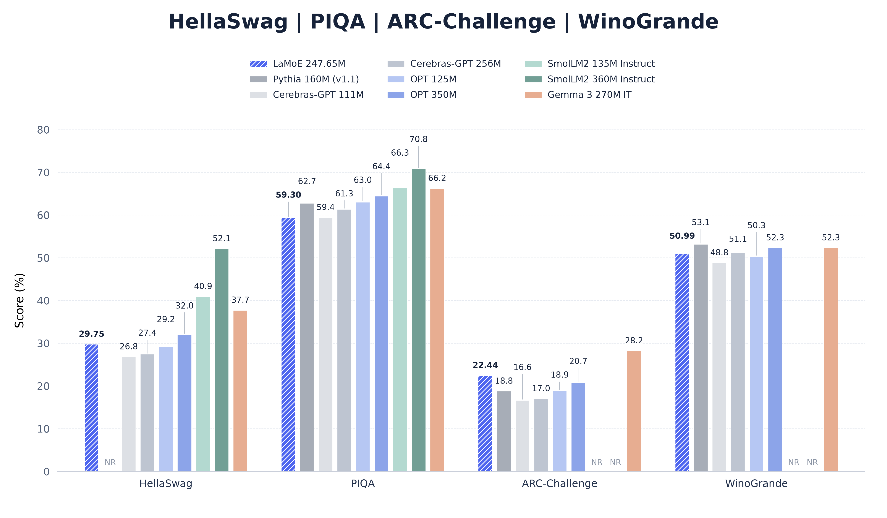
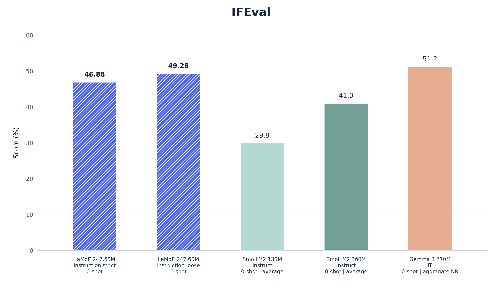
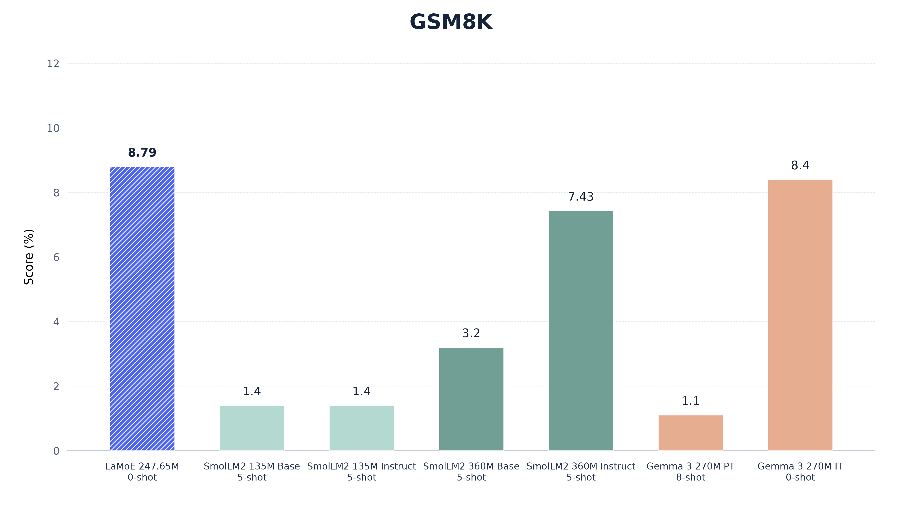
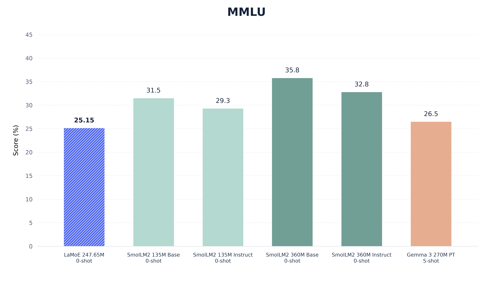
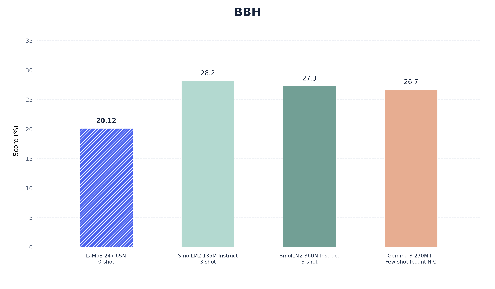
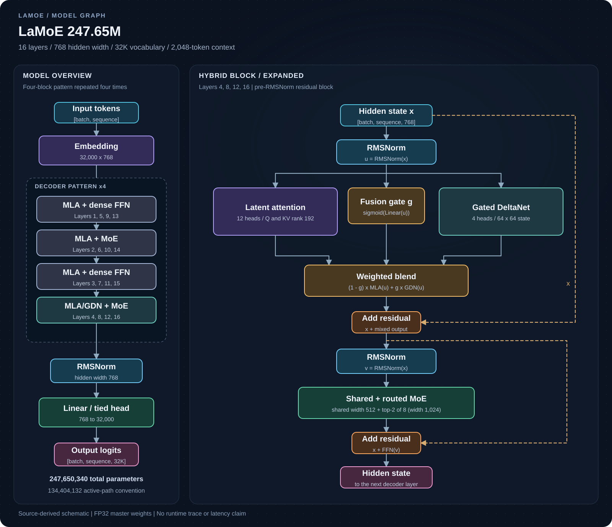

# LaMoE

**247.65M-parameter hybrid language model with Multi-head Latent Attention,
Gated DeltaNet and mixture-of-experts feed-forward layers.**

LaMoE was pretrained on **25.5 billion tokens**, followed by supervised
fine-tuning (SFT), using **Google Colab and Modal**. The released source covers
the model, local preprocessing, pretraining, SFT, inference and evaluation.
**Data-collection code and the private corpus are not distributed.**
The source code is public under Apache-2.0. The Transformers-compatible model
export is publicly available at
[`IMvision12/lamoe-247`](https://huggingface.co/IMvision12/lamoe-247). Model
weights and the matching frozen tokenizer are stored there, separately from
this source repository.

## Benchmark graphs

These five figures cover the selected **eight benchmarks**. Blue hatched bars
are LaMoE's local measurements; the other bars are published reference results.
Reference prompts, shot counts, normalization, metric aggregation and generation
budgets differ. These figures provide context rather than a matched ranking.
See [the source register](docs/benchmark_sources.json) and
[evaluation protocols](docs/EVALUATION.md) for those differences. `NR` means a
suitable value was not reported in the selected source, not a zero score.

### HellaSwag, PIQA, ARC-Challenge and WinoGrande

LaMoE bars use raw choice accuracy. Published SmolLM2 and Gemma model-card scores
may use different scoring conventions from the local raw metric.



### IFEval

LaMoE shows **instruction strict and instruction loose** accuracy. The SmolLM2
cards report a prompt/instruction average, while Gemma's published aggregate is
unspecified. Those bars do not all measure the same IFEval aggregate.



### GSM8K

LaMoE shows **0-shot flexible-extraction exact match**. Reference rows differ in
shot count, prompting and scoring, including exact match versus pass@1. The
separate local strict-extraction result remains in the full results table/CSV.



### MMLU

LaMoE is **0-shot raw multiple-choice accuracy**, weighted by all 14,042 questions
across 57 subjects. Published cloze and few-shot results use different settings.



### BBH

LaMoE shows **0-shot CoT flexible-extraction exact match**, weighted by 6,511
questions across 27 official task variants. References use few-shot prompts and
potentially different aggregation. The local strict metric is retained in the CSV.



## Model architecture

| Property | Value |
| --- | --- |
| Total parameters | 247,650,340 |
| Active-path parameters | 134,404,132, including the entire embedding matrix |
| Decoder | 16 layers, width 768 |
| Context | 2,048 tokens |
| Vocabulary | 32,000, tied embedding/output weights |
| Sequence mixing | MLA in every layer; soft MLA/GDN fusion in layers 4, 8, 12, 16 |
| FFN | Alternating dense SwiGLU and top-2 of 8 routed experts with a shared expert |
| Code license | Apache-2.0 |

Active-path parameters are a counting convention, not a FLOPs or latency claim.
See [the architecture](docs/MODEL.md) and [evaluation protocols](docs/EVALUATION.md).

The decoder repeats this four-block pattern four times, with independent weights
in every block. Each block uses pre-RMSNorm and residual connections around both
sequence mixing and its feed-forward network.

[](docs/architecture/model.svg)

[Open interactive architecture explorer](docs/architecture/index.html) ·
[Download PNG](docs/architecture/model.png) ·
[MLA detail](docs/architecture/mla.svg) · [MoE detail](docs/architecture/moe.svg)

The color-coded module graph is inspired by [HF Viewer](https://hfviewer.com/).
It is derived from LaMoE's local source/configuration, rather than a runtime
trace or an HF Viewer export. The interactive explorer works locally without
network access and supports module selection, search, pan, zoom and detailed
MLA/MoE views. Open `docs/architecture/index.html` in a browser after downloading
the source; code hosting sites may display the file as source instead of running it.

| Component | Configuration |
| --- | --- |
| MLA | 12 heads; query/KV ranks 192; per-head content Q/K 48, RoPE Q/K 16, value 64 |
| Hybrid layers | Layers 4, 8, 12 and 16; per-token scalar gate blends `(1-g) * MLA + g * GDN` |
| Gated DeltaNet | 4 heads, 64 x 64 recurrent state per head; causal convolution width 4 |
| Dense SwiGLU | Odd-numbered layers; intermediate width 2,048 |
| Routed MoE | Even-numbered layers; top-2 of 8 experts, intermediate width 1,024 each |
| Shared expert | Always active in MoE layers; intermediate width 512 |
| Position and boundaries | Decoupled RoPE; document-aware masks and recurrent-state resets |
| Decoding cache | Compressed MLA KV latents, GDN recurrent state and convolution history |

Both MLA and GDN branches execute in hybrid layers. The fusion gate blends their
outputs; the separate FFN router selects experts without capacity-based token
dropping. The evaluated baseline does not enable the optional MLA head gate.

## Completed local evaluations

These checkpoint results were measured on an **RTX 4060 laptop GPU**, using a
2,048-token context. This describes evaluation hardware, not the entire training
run. All local rows below are **0-shot**. Metrics use their own denominators.

| Benchmark | Metric | Score |
| --- | --- | ---: |
| HellaSwag | Raw accuracy | 29.75% |
| PIQA | Raw accuracy | 59.30% |
| ARC-Challenge | Raw accuracy | 22.44% |
| WinoGrande | Accuracy | 50.99% |
| IFEval | Instruction strict / loose | 46.88% / 49.28% |
| IFEval | Prompt strict / loose | 32.53% / 34.01% |
| GSM8K | Flexible / strict extraction exact match | 8.79% / 0.0758% |
| MMLU | Question-weighted accuracy, 57 subjects | 25.15% |
| TriviaQA | Exact match | 1.08% |
| BBH | Flexible / strict extraction exact match, 27 tasks | 20.12% / 4.32% |
| MBPP-Instruct | Greedy pass@1 | 13.80% |
| HumanEval-Instruct | Greedy pass@1 | 15.24% |

All **19 metric rows across 11 completed runs** are retained in
[results/benchmarks.csv](results/benchmarks.csv), including normalized choice
scores and both extraction metrics. Strict and flexible extraction are distinct
metrics. A cross-benchmark average is not reported.

The full breakdowns are available as [57 MMLU subjects](results/mmlu_subjects.csv)
and [27 BBH task variants](results/bbh_tasks.csv), with integer counts and
question-weighted totals matching the paper's appendices.

The selected presentation charts cover eight benchmarks. Their published model
references use different prompts, scoring conventions, shot counts and training
regimes. They provide context, not a controlled head-to-head ranking. Read
[the protocol notes](docs/EVALUATION.md) before sharing the simplified charts.
Training-data overlap has not been exhaustively audited.

## Setup

Python 3.11+ is required. Install the appropriate PyTorch build for your own
machine, then install this source folder in your environment:

```sh
python -m pip install -e ".[preprocessing]"
python -m lamoe.model
```

The default CPU runtime uses the explicit reference GDN recurrence. CUDA/FLA
and FlashAttention are optional, hardware-specific dependencies. They are not
installed automatically by this package. Validate those paths on your own host.
Validation used small synthetic CPU fixtures; the test suite is not included
in this source distribution. Tested configurations and limits are recorded in
[the validation record](docs/VALIDATION.md).

## Local inference

Provide a checkpoint containing `config.json` and `model.safetensors`, together
with its **matching frozen** `tokenizer.json`:

```sh
python -m lamoe.inference --checkpoint /path/to/checkpoint --tokenizer /path/to/tokenizer.json --prompt "Explain binary search." --max-new-tokens 128 --device cpu
```

The default is native user/assistant chat, without an injected identity or system
message. `--raw` selects native-BOS completion. JSON output includes the generated
text, token IDs, counts and stopping reason. Inputs are not truncated. Output is
capped by the remaining context. This command does not execute tools or code.

For a compatible CUDA environment, select `--device cuda --gdn-backend fla`.
Model loading checks vocabulary size and optional `--expected-sha256`; matching
the original tokenizer is still the caller's responsibility.

## Transformers support

The optional [Transformers adapter](docs/TRANSFORMERS.md) supports
`AutoConfig`, `AutoTokenizer` and `AutoModelForCausalLM`, including `.generate()`.
It was tested with Transformers **5.17.0** on CPU and, in a separate WSL smoke
test, on an RTX 4060 using FP32 reference GDN and SDPA. Move both the model and
tokenized inputs to CUDA when using a GPU. The Hub stores model weights,
tokenizer and configuration files; all Python implementation code stays in this
source repository. Install the source package and call
`from lamoe.transformers import register; register()` before using AutoClasses.
Use `trust_remote_code=False` with this layout.
Model artifacts are maintained separately at
[`IMvision12/lamoe-247`](https://huggingface.co/IMvision12/lamoe-247).
The Transformers-compatible export is publicly available there.

```sh
python -m pip install -e ".[transformers]"
python -m lamoe.transformers.export --checkpoint /path/to/checkpoint --tokenizer /path/to/tokenizer.json --output /path/to/new-transformers-export
```

Export preserves the original trained tensors and frozen tokenizer. No weights,
datasets or tokenizer payloads are included in this source repository. Native
`lamoe.inference` remains available. See the guide for examples and cache limits.

## Training and SFT

Training-data loading uses these three repositories only:

| Data | Hugging Face dataset |
| --- | --- |
| Raw pretraining text | [`IMvision12/LaMoE-Dataset`](https://huggingface.co/datasets/IMvision12/LaMoE-Dataset) |
| Pre-tokenized pretraining shards | [`IMvision12/LaMoE-Tokenized`](https://huggingface.co/datasets/IMvision12/LaMoE-Tokenized) |
| Main SFT and identity correction | [`IMvision12/lamoe-sft`](https://huggingface.co/datasets/IMvision12/lamoe-sft), configurations `main` and `identity` |

All three dataset repositories are private and require authorized Hugging Face
access. The raw pretraining and SFT archives are uploaded. The tokenized repository
currently contains metadata only; its reader requires a complete `lamoe-bin-v1`
snapshot before it can load the corpus.

Readers resolve `main` to an immutable revision, verify file hashes and preserve
the dataset splits.
They do not run remote dataset scripts, collect data or upload files.

```sh
python -m lamoe.preprocessing snapshot --output /path/to/raw-snapshot
python -m lamoe.preprocessing token-snapshot --output /path/to/token-snapshot
python -m lamoe.sft prepare --config main --tokenizer /path/to/tokenizer.json --output /path/to/main-sft
python -m lamoe.sft prepare --config identity --tokenizer /path/to/tokenizer.json --output /path/to/identity-sft
```

The raw path supports local tokenization with the existing preprocessing commands.
The tokenized path loads existing `lamoe-bin-v1` files without re-tokenizing them.
SFT preparation streams the original JSONL through the frozen chat tokenizer and
writes assistant-masked Parquet files. It does not start training.

- [Preprocessing and pretraining](docs/TRAIN.md): loading the uploaded
  raw or tokenized dataset, local Parquet input contracts,
  tokenizer preparation, screening, binary packing, Muon/AdamW, token schedules
  and checkpoint resume.
- [SFT](docs/SFT.md): main/identity loading and tokenization, assistant-only labels,
  local JSONL/Parquet inputs, a portable
  AdamW baseline and explicit epoch-boundary resume.
- [Evaluation](docs/EVALUATION.md): a portable harness adapter, metric definitions,
  historical protocols and the limits of cross-model comparisons.

The portable SFT baseline and public proportional token planner are newly
separated interfaces. They do not recreate the private historical curriculum or
claim to reproduce the released checkpoint from public files alone.

## Source layout

```text
lamoe/model/          Exact model implementation used by the local checkpoint
lamoe/preprocessing/  Raw/tokenized dataset loading, cleaning, BPE and token packing
lamoe/train/          Single-device pretraining, optimizers and resume
lamoe/sft/            Main/identity dataset loading, tokenization and local SFT
lamoe/inference.py    Local cached greedy inference
lamoe/evaluation/     Optional lm-evaluation-harness adapter
lamoe/transformers/   Optional Transformers wrapper, cache, chat template and exporter
configs/             Full and tiny architecture configurations
docs/                Protocols, release notes and selected charts
results/             Aggregate completed local evaluation metrics
```

## Release scope

The training-data readers use only the three repositories listed above,
with revision pinning and file hash checks. They contain no collection or upload
workflow. Benchmark evaluation references are retained.

External dependencies, datasets, benchmarks and reference weights retain their
own terms.
See [distribution details](docs/RELEASE.md) and [LICENSE](LICENSE).
